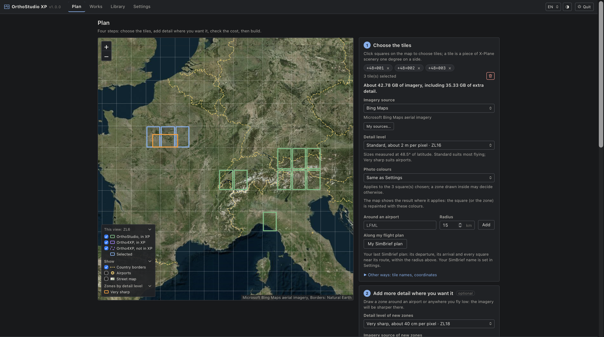
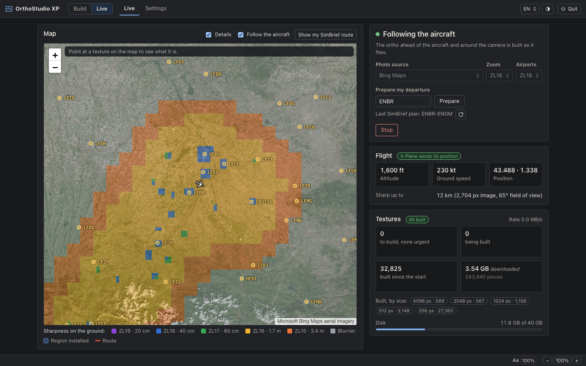

# OrthoStudio XP

Orthophoto scenery for X-Plane 12 (XP12), two ways, in one app: tiles you build once, or aerial
imagery downloaded while you fly. Both from a page that says in plain words what it is doing.
OrthoStudio XP is a new program built on the rules of
[Ortho4XP](https://github.com/oscarpilote/Ortho4XP), which Oscar Pilote and its contributors have
refined for ten years: it makes the same kind of tiles, with a different architecture that builds
them faster. It would not exist without Ortho4XP.

**Status: building tiles is stable since 1.0; flying with Live comes with 2.0.** OrthoStudio XP
builds and installs tiles end to end on macOS, Windows and Linux, with their installers, each built
and checked automatically at every release.

## Two ways to fly over photos

| Build your tiles: **OrthoStudio XP** | Fly now: **OrthoStudio XP Live** |
|---|---|
|  |  |
| Choose the regions you fly over and build them once, at the best quality: nothing to download in flight, your tiles stay on your disk. It takes computing time and disk space. | Choose a flight anywhere: the imagery is downloaded while you fly, ahead of the aircraft, with no tiles to build. X-Plane never waits in flight. It needs the internet, and the mesh of the regions you fly over, installed from the app. |
| [The guide to building tiles](docs/build.md) | [The guide to flying with Live](docs/live.md) |

Both at once: build your tiles where you want them (your airport, your region), and Live takes
care of the rest; X-Plane shows your tiles first.

## Getting started

Requirements: X-Plane 12, and macOS 15 or later (Apple Silicon or Intel), Windows 10 or 11
(64-bit) or a 64-bit Linux. Download the installer of your system from the releases of this repository; each has
Python inside.

- **macOS**: open `OrthoStudio-XP-<version>-macos-arm64.dmg` on Apple Silicon, or
  `OrthoStudio-XP-<version>-macos-x86_64.dmg` on an Intel Mac, and drag *OrthoStudio XP* to
  Applications. The app is not signed yet, so macOS refuses to open it the first time: open
  *System Settings*, *Privacy & Security*, click *Open Anyway* next to OrthoStudio XP and confirm.
  If macOS says instead that the app is damaged, run this once in the Terminal:
  `xattr -dr com.apple.quarantine "/Applications/OrthoStudio XP.app"`.
- **Windows**: run `OrthoStudio-XP-<version>-windows-x64-setup.exe`. Not signed yet either: in the
  *Windows protected your PC* window, click *More info*, then *Run anyway*. It installs for your
  user alone, without administrator rights, and adds OrthoStudio XP to the Start menu. Its window
  is drawn by Microsoft's WebView2 Runtime: the installer offers it when the PC lacks it, and offers
  to update it when the PC's is too old (before version 101, of 2022), which Windows lets through
  only with an administrator's permission. Turned down, OrthoStudio XP opens in your browser.
- **Linux**: extract `OrthoStudio-XP-<version>-linux-x86_64.tar.gz` where you want to keep it, then
  run `./install.sh` in the extracted folder for an entry in the applications menu, or start
  `./orthostudio-xp` directly.

Opening OrthoStudio XP shows its page in a window of its own, which works like any window on your
system; opening it again brings that window back. It keeps a browser's habits: Cmd+F or Ctrl+F
finds text on the page, and Cmd or Ctrl with `+`, `-` and `0` changes the text size, which it
remembers. When a newer version is out, a line at the top of the page says so, with a link to its
release page: nothing is downloaded or installed, GitHub is asked once a day at most, and Settings
can turn it off. Quitting stops the engine, and asks first when a
build is running: what was already built is kept, so building again carries on from there. On
Linux it opens in your browser instead, as every version has: the web view a window needs there is
built for your distribution's own Python, and OrthoStudio XP carries its own, so installing it
would change nothing. In a browser it stops by itself five minutes after the last page is closed,
with no build running or waiting. What it does, stage by stage, and how long each start took go
to `serve.log`, in
`~/Library/Logs/OrthoStudio XP` (macOS), `%LOCALAPPDATA%\OrthoStudio XP\Logs` (Windows) or
`~/.orthostudio/log` (Linux, beside the rest of what it keeps). Your tiles and settings stay in `~/.orthostudio` (the
tiles in the data folder chosen in Settings, if you chose one) when the app is removed.

Going back to an older version works as is, unless *Free space* deleted the data kept for older
versions: that version then refuses the data folder. Quit OrthoStudio XP and delete the `store`
folder inside the data folder (the folder *Disk space* names). Your tiles stay whole and in
X-Plane; that version calculates everything again to rebuild one, without downloading the images
again unless you deleted them.

At its first start the app asks what you want to do: build your tiles, or fly now with
OrthoStudio XP Live (from 2.0). Both are in its one window, Build | Live at the top. To
fly with Live: install the mesh of where you fly (Live's Settings, first question), then Start Live
and Start X-Plane; the steps are in [docs/live.md](docs/live.md#a-flight-step-by-step).

OrthoStudio XP runs entirely on your computer: its screens are a page it serves itself, at
127.0.0.1, shown in a window of its own. Nothing goes through a server of ours, and its downloads
from the imagery, map and elevation services go over HTTPS, except a source you add yourself with
an `http://` address. Opened in a browser instead, the page may be called "not secure" because it
is not HTTPS, which is harmless here: it never leaves your computer.

### From the source

Requirements: Python 3.12 or later, [uv](https://docs.astral.sh/uv/), CMake and a C compiler.

```bash
git clone <this repository> orthostudio-xp
cd orthostudio-xp
uv sync --all-extras --all-groups
cmake -S native/triangle4xp -B native/triangle4xp/build -DCMAKE_BUILD_TYPE=Release
cmake --build native/triangle4xp/build --config Release
uv run osxp doctor          # checks Python, the encoder, the network client, X-Plane, the disk
uv run osxp serve --open    # the page, at http://127.0.0.1:8641
```

On macOS, `uv run python tools/package/checkout_app.py` makes `dist/OrthoStudio XP.app`, an app
that runs this checkout. `uv run python tools/package/build.py --check` builds and checks the
installer of the system it runs on (`docs/specs/packaging.md`).

Started again while it runs, OrthoStudio XP shows the running one, unless the code changed in
between (a pull, another branch, an edit): the one started before is then stopped and the new
code starts, a build running in it excepted.

Quit X-Plane before installing or removing tiles: OrthoStudio XP refuses to change the scenery while
it runs.

The same from a terminal, where `osxp` is the short name of the `orthostudio` command:

```bash
uv run osxp plan --tile +46+006                 # size and time before building
uv run osxp build --tile +46+006 --install      # build and install
uv run osxp library                             # the tiles OrthoStudio XP knows
uv run osxp uninstall +46+006                   # out of X-Plane, files kept
uv run osxp uninstall +46+006 --delete          # deleted for good
uv run osxp clean --all                         # give back all the space OrthoStudio XP can
```

<a id="build-times-measured"></a>

## Building tiles

OrthoStudio XP builds orthophoto tiles on the rules of Ortho4XP, with a different architecture
that builds them faster.

- **A map to choose from**: click the squares you want, draw sharper zones around airports or where
  you fly low, and see the cost (disk, download, time) before you build.
- **Fast**: a ZL16 tile with nothing in the cache in 53 s, an unchanged tile again in under 0.1 s
  (Apple M4 Pro, home connection of 418 to 485 Mbit/s).
- **Settings in plain words**, three presets, and every Ortho4XP setting still under "For experts".
- **Installation handled**: each tile in Custom Scenery in the order X-Plane needs, with its roads,
  forests and buildings, and a Library of every tile on the computer.

Its guide, with what you get, the measured build times and the comparison with Ortho4XP:
[docs/build.md](docs/build.md).

## Flying with Live

OrthoStudio XP Live, from 2.0, works as XPME and AutoOrtho do from the pilot's seat, with
no virtual disk between X-Plane and its textures: it builds them beside X-Plane as ordinary files.

- **X-Plane never waits in flight.** It waits only on its loading screen at a flight's start; with
  "Prepare my departure before starting the flight", not even there.
- **If Live stops, X-Plane flies on** over what is on the disk.
- **Measured on the same flight**: the ground ready about twice as fast as with XPME and five times
  as fast as with AutoOrtho, for a third of a processor core.
- **Your own tiles come first**: Live downloads nothing where you built one.
- **Seasons**: the photos in the colours of the season of your flight's date in X-Plane, or of
  the one you choose.
- **Towns at night**: street lamps and windows along X-Plane's roads on Live's photos, as many
  lit as NASA's Black Marble sees there; soft, normal or strong, or none.

Its guide, with the steps of a flight, the window and the measurements:
[docs/live.md](docs/live.md).

## Reporting a problem, asking for a feature

- **A problem**: open an issue in this repository
  ([New issue](https://github.com/radioharris/orthostudio-xp/issues/new/choose)). Its form asks for
  what helps find the cause: the version, your system, what you did and what you saw, the tile, a
  screenshot, and the log `serve.log`. The issues are kept for what goes wrong.
- **An idea or a request**: start a discussion in
  [Ideas](https://github.com/radioharris/orthostudio-xp/discussions/categories/ideas). Its form asks
  what you would like, why, how you do it today, and examples. Others can vote for it and add what
  they need, so the ideas with the most votes are the roadmap's starting point.
- **A question**: ask it in
  [Q&A](https://github.com/radioharris/orthostudio-xp/discussions/categories/q-a).

Without a GitHub account, the comments on OrthoStudio XP's page on X-Plane.Org are read too.

## Imagery and responsible use

OrthoStudio XP downloads imagery from public map services for your personal use in X-Plane, as
Ortho4XP does. Their terms of use apply to you; many forbid redistributing the imagery. Do not share
or sell tiles built from them. You can add a source OrthoStudio XP does not ship (*My sources…* in
the Plan): you add it yourself, and its terms apply to you as well.

## Relationship to Ortho4XP and licences

OrthoStudio XP is Copyright (C) 2026 radioharris, licensed under the GNU GPL v3 or later (`LICENSE`,
`NOTICE`). `NOTICE` adds three terms that section 7 of the GPL v3 allows: the author's credit is
kept, a modified version carries a name of its own, and the licence gives no right to the name
OrthoStudio XP. They cover radioharris's own material, not what comes from Ortho4XP nor the
programs below, and each source file says so in its first two lines.

OrthoStudio XP ports the X-Plane domain rules of Ortho4XP (coastlines, airports, masks, DSF
encoding, provider definitions) into a new architecture. It is therefore a derivative work and is
licensed under the GPL v3, like Ortho4XP. Thanks to Oscar Pilote and the Ortho4XP contributors for
ten years of work on those rules. OrthoStudio XP does not need Ortho4XP: it never imports, runs or
reads it, and includes none of its files apart from two small data images (`world_tiles.png`,
`water_transition.png`) and the two programs below. The one link left is the import of the tiles
an Ortho4XP folder built, so they can be installed and removed from the Library (decision 0010).

Triangle4XP (Jonathan Shewchuk's Triangle, modified by Oscar Pilote) stays a separate program,
distributed free of charge with its sources and a notice of its modifications, as its licence
requires: see `native/triangle4xp/`. Its licence forbids including it in a commercial product
without the author's agreement.

DSFTool (Laminar Research's X-Plane Scenery Tools, MIT/X11 licence) extracts the overlays: its
macOS, Windows and Linux binaries are in `native/dsftool/`, with their checksums.

The cloud detector is the two networks of
[OmniCloudMask](https://github.com/DPIRD-DMA/OmniCloudMask) (DPIRD-DMA, MIT licence), converted for
OpenCV by `tools/clouds/export_detector.py`; its licence comes with the app. The networks and
[OpenCV](https://opencv.org) (Apache 2.0 licence, its own wheel from PyPI with its licences inside)
are not in the installer: the app downloads them once, at the user's word (about 110 MB), and checks
them against their digests.

Map data © [OpenStreetMap contributors](https://www.openstreetmap.org/copyright), under the Open
Database Licence (ODbL): OrthoStudio XP reads the airports, roads, coastline and water of each
tile from its own library, cut from OpenStreetMap's planet file (how:
`docs/specs/osm-prepared.md`, section 8), or from public Overpass servers when the library cannot
answer, to shape its terrain. Like the
imagery, the tiles built from them are for your own use.

The page's street map comes from [OpenFreeMap](https://openfreemap.org) (© OpenMapTiles, data ©
OpenStreetMap contributors), read through the engine so the page contacts nothing but its own
address. Base-map borders: Natural Earth (public domain). Map libraries: Leaflet (BSD-2-Clause)
and MapLibre GL (BSD-3-Clause), both vendored.

## Development

```bash
uv sync --all-extras --all-groups
uv run pytest -n 8 -m "not network"   # the suite, in parallel
uv run ruff check .
uv run mypy src
```

Tests marked `xplane` read the local X-Plane 12 install (never write to it) and skip without it.
Network tests (`-m network`) are never run in CI. No test needs Ortho4XP.

## Layout

```
src/orthostudio/  the package: graph and store, network, sources, vectors, mesh, masks,
                  imagery and textures, DSF, packs, install, API, web page (ui/), CLI
native/           Triangle4XP sources and build, DSFTool binaries
docs/build.md          the guide to building tiles
docs/live.md           the guide to flying with OrthoStudio XP Live
docs/how-it-works.md   the user's guide to what OrthoStudio XP does and keeps
docs/decisions/   architecture decision records
docs/specs/       behaviour specifications, written before each ported rule
docs/benchmarks/  the measurements behind each design choice
tools/            network benchmarks, borders data, the installers (package/)
tests/
```

## Support OrthoStudio XP

OrthoStudio XP is free. If it brings you nicer flights and you feel like saying thanks,
a donation is very welcome: it pays for the coffee (and the occasional avgas) behind the
next versions. No pressure, though: reporting a problem or sharing an idea helps just as much.

[](https://paypal.me/radioharris)
