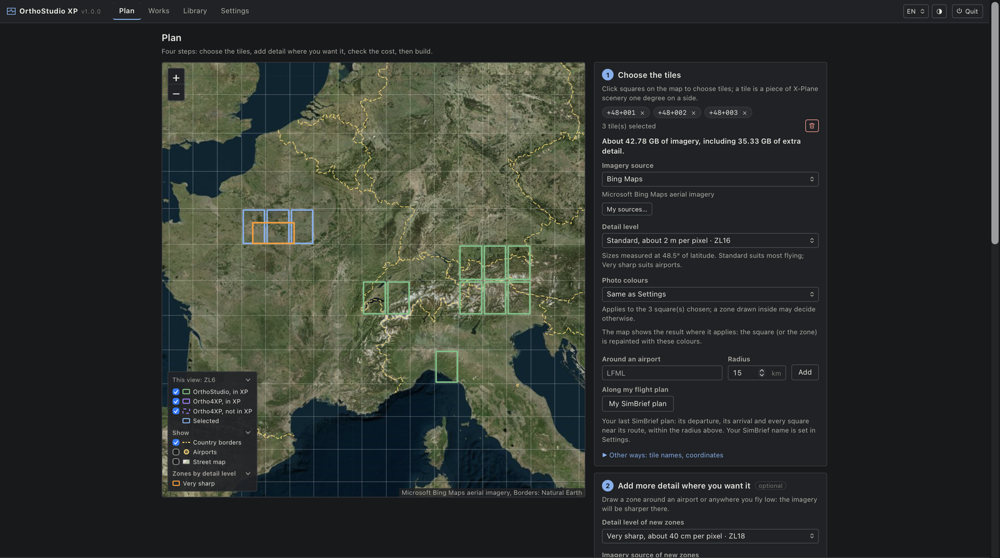
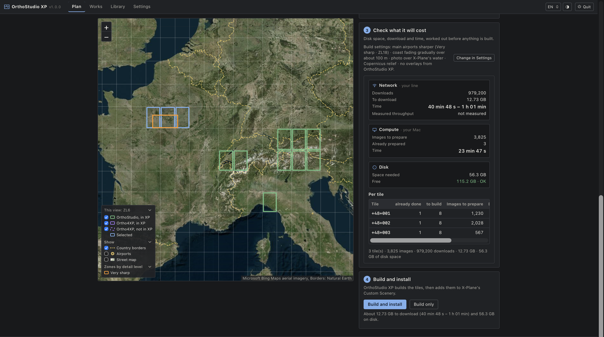
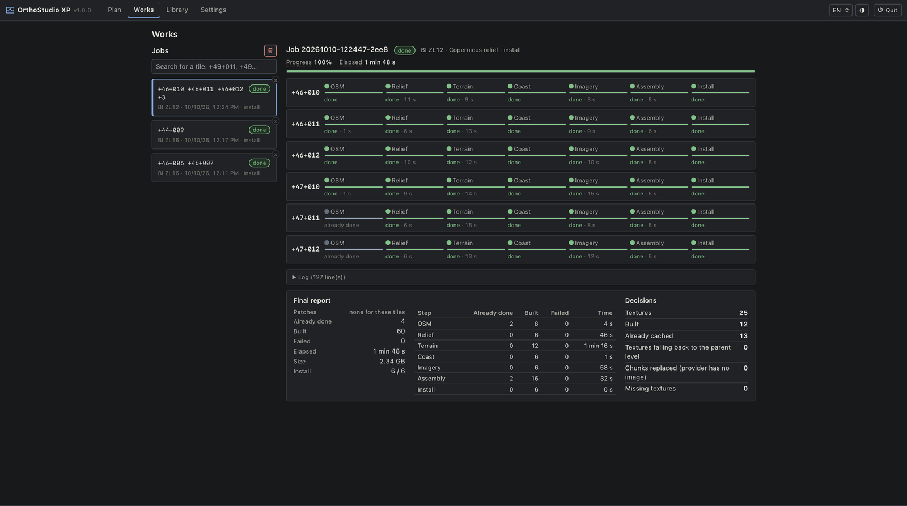
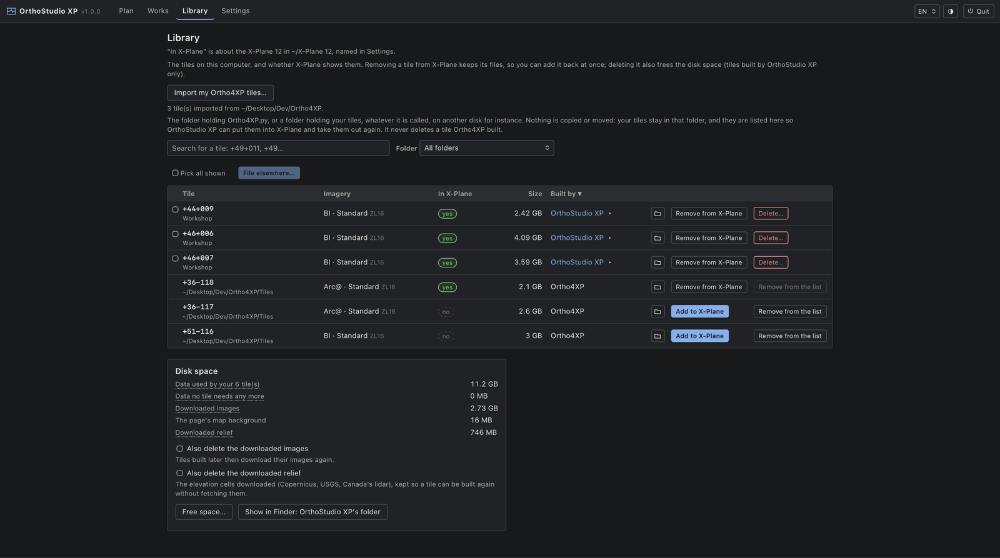
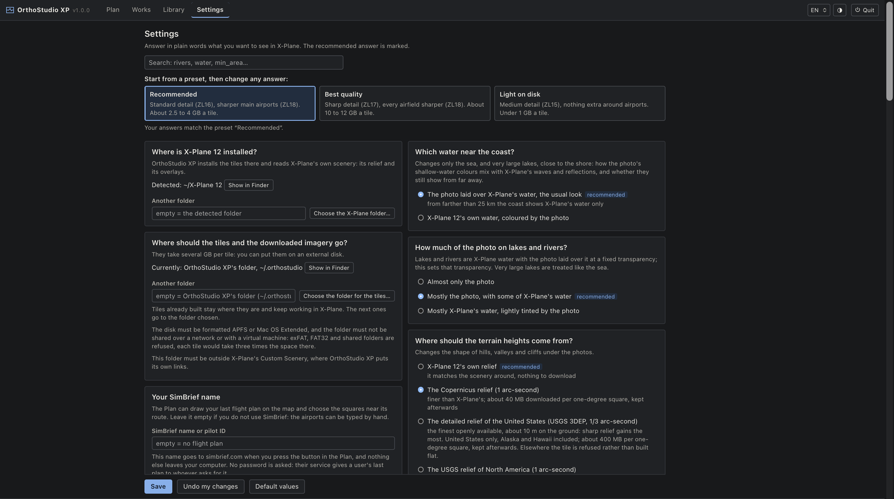

# Building tiles with OrthoStudio XP

A guide for pilots who build their own tiles: what OrthoStudio XP gives, what to know before a
first build, how long a build takes, and how it compares with Ortho4XP. Installing the app is in
the [README](../README.md#getting-started); how a build works, step by step, and what it keeps on
the disk is in [how-it-works.md](how-it-works.md). To fly without building tiles, see
[OrthoStudio XP Live](live.md).

## What you get

- **A map to choose from.** Click the squares you want or draw a rectangle over them, and draw
  sharper zones around airports or where you fly low. It shows the aerial imagery or the street
  map, the airports with their ICAO codes, the tiles you already have, and what the view is worth
  on the ground in the zoom levels a build works in.
- **The cost before you build**: disk space, download and time, then build and install in one
  click.
- **Works, as it happens.** A bar for every step of every tile, the time left, errors that say what
  happened and what to do, and a button to fetch again only what is missing. Builds queue up, up to
  500 tiles each.
- **Settings in plain words.** Questions about what you want to see in X-Plane, three presets, and
  every Ortho4XP setting under "For experts" with a plain label.
- **A Library.** Every tile on the computer, its size, whether X-Plane shows it and what it was
  built with, searched, sorted and opened in its folder. Take a tile out of X-Plane and back,
  delete it, file it on any disk ([workshop.md](workshop.md)), and free the space the
  cache takes. Tiles built with Ortho4XP are listed too, and never deleted.
- **Installation handled.** Each tile goes into Custom Scenery in the order X-Plane needs, with its
  roads, forests and buildings (left out when simHeaven X-World brings its own) and a backup of
  `scenery_packs.ini`.
- **Map data in seconds.** The airports, roads, coastline and water of every tile of the planet
  come from OrthoStudio XP's own library (OpenStreetMap as of 7 October 2026, updated regularly),
  and from the public Overpass servers when the library cannot answer.
- **Relief from X-Plane 12 itself**, nothing to download, or a finer one: Copernicus, the USGS
  over North America, Canada's lidar, ANADEM over South America, or your own elevation files at
  their own resolution. Works says which relief a build actually read, and a tile outside a
  source's coverage is refused, never built flat.
- **The colours of the photos, seen on the map**: as delivered, toned down, or by your own numbers,
  for everything, one square or one zone. Changing them builds a tile again without downloading
  anything.
- **The grain of the ground.** One of X-Plane 12's decals over the photos, the one you choose;
  turning it on, off or to another writes a tile's terrain files again, and nothing else.
- **The squares of a flight plan.** Your last SimBrief plan chooses the squares along its route,
  within the radius you set.
- **Hand-made mesh patches**, those published for Ortho4XP included, read as they come.
- **A cache.** An unchanged tile builds again in a fraction of a second, a new zone builds again
  only what it touches, and imagery is never downloaded twice.
- **Your disk of choice.** Tiles are built in the workshop, the data folder chosen in Settings, then
  filed wherever you want; an unplugged disk is said as such, and nothing is written in its place.
- **Text as large as you need.** `− 100 % +` zooms the whole page and `Aa` makes the text alone
  larger; the window opens where you left it.

How it works, what it keeps on disk and how to clean it:
[how-it-works.md](how-it-works.md).

| What it will cost | Works |
|---|---|
|  |  |

| Library | Settings |
|---|---|
|  |  |

## Before a first build

OrthoStudio XP works with the X-Plane 12 of the same computer: it takes the relief, roads, forests
and buildings from X-Plane's scenery and adds the tiles to its Custom Scenery. The part of the
world you build must be installed in X-Plane 12, whose installer lets you choose which parts: step
3 of the Plan says when a square's is not. The regions of X-Plane's demo (Maui to Kauai, the coast
of Oregon and Washington, south-east Alaska), which its installer keeps in `X-Plane 12 Demo Areas`,
are read there. It finds X-Plane by
itself; when it cannot (X-Plane in an unusual folder, or a virtual machine whose X-Plane is on the
host), step 3 of the Plan says so, and its button opens the Settings question where you choose
the folder.

An antivirus with a behaviour-based ransomware protection (Trend Micro's, for one) may take a build
for ransomware and stop it: a build writes thousands of files in a few minutes, compressed
textures that look as random as encrypted files do, replaces files by writing new ones, and adds
links and a line to `scenery_packs.ini` in X-Plane's folder. If yours does, allow OrthoStudio XP
in its settings: the program is in `%LOCALAPPDATA%\Programs\OrthoStudio XP` on Windows, and its
data in `.orthostudio` in your user folder (or the data folder chosen in Settings).

## Build times, measured

Measured on 10 October 2026 with OrthoStudio XP 1.0, on a MacBook Pro (Apple M4 Pro, 14 cores,
48 GB of memory) and a home connection measured at 418 to 485 Mbit/s down before and after each
build, with the tile of Geneva, `+46+006`, and a new user's settings: Bing imagery, X-Plane's own
relief, its roads, forests and buildings. Every step, the data folder and the command:
[benchmarks/build-times-1.0.md](benchmarks/build-times-1.0.md).

| A first build, nothing in the cache | ZL16 | ZL18 |
|---|---:|---:|
| The whole tile | **53 s** | **6 min 27 s** |
| Textures | 213 | 2,902 |
| Images downloaded | 733 MB | 8.5 GB |
| On the disk, cache included | 3.8 GB | 41 GB |

| The steps of that first build | ZL16 | ZL18 |
|---|---:|---:|
| Map data (from the library) | 2.7 s | 2.9 s |
| Relief (X-Plane's own) | 4.5 s | 4.8 s |
| Roads, water and airports traced | 7.0 s | 7.4 s |
| Mesh | 3.5 s | 3.7 s |
| Water masks | 0.9 s | 0.9 s |
| DSF | 2.4 s | 3.0 s |
| Roads, forests and buildings for X-Plane, alongside | 3.2 s | 3.4 s |
| Imagery, downloaded and compressed | 34 s, at 21.7 MB/s | 6 min 4 s, at 23.2 MB/s |

The steps before the imagery run partly side by side, so the imagery starts after 19 s at ZL16
and 20 s at ZL18.

| The same tile afterwards | Time | Downloaded |
|---|---:|---:|
| Built again, nothing changed | **under 0.1 s** | nothing |
| Other colours for the photos | 14 s | nothing |
| Decals turned on, or another decal | 0.2 s | nothing |
| A ZL18 zone drawn around the airport | 6.6 s | 20 MB |
| Another relief (Copernicus) | 40 s | the relief, no image |
| Stopped halfway through, then started again | 17.6 s to finish | the 373 MB left |

Stopped after 38 s and started again, the tile downloaded 360 MB, then 373 MB: the 733 MB of a
build that was not stopped. OrthoStudio XP runs the steps of all the tiles as a graph over every
core, downloads over HTTP/2 with up to 128 requests in flight, compresses textures in-process,
and files every result under what produced it: it finds by itself the steps whose inputs did not
change, and does not run them again.

## Compared with Ortho4XP

A measured comparison, made in September 2026 on the same Mac against Ortho4XP's code of March
2026: [benchmarks/ortho4xp-comparison.md](benchmarks/ortho4xp-comparison.md).

Other differences in use:

| | Ortho4XP | OrthoStudio XP |
|---|---|---|
| Settings | 57 parameters in its configuration window, named as in its code | questions in plain words, three presets, every parameter still under "For experts" |
| Errors | messages in its log | coded errors with a remedy, on the step that failed |
| An image piece that does not arrive | tried at a lower zoom level, then filled with white, and said in the log | asked for again after a pause, from another server; a tile still missing some is not installed |
| Progress | a bar per step of the tile being built, and the log | a bar per step of every tile, the whole build's progress and time left |
| Installation | a link created from its tile map (Ctrl+click); the order in `scenery_packs.ini` is left to X-Plane and to you | from the page in one click, in the order X-Plane needs, with a backup, reversible |
| Several tiles | built one after the other (batch build) | built side by side, with sharper zones spanning tiles |

Ortho4XP remains the reference, and does things OrthoStudio XP does not do:

- **many more imagery sources**: 71 definitions, mostly national, against 13 checked ones here (a
  source of your own can be added in the page), and a **combined** layer that stitches several of
  them into a single texture, each with its own extent, priority and colour filter, where
  OrthoStudio XP uses one source per tile, or per zone drawn inside it;
- **a richer treatment of the imagery**: sharpness, blur and per-channel levels with gamma, beside
  the brightness, contrast and colour OrthoStudio XP applies when it encodes the textures;
- **X-Plane 11** as well, where OrthoStudio XP builds for X-Plane 12 only.

Its colour filters (`.flt`) and its hand-made mesh patches (`Patches`) are here since 0.1.3 and
0.1.4: patches written for Ortho4XP are read as they are, and the colours are set for everything
you build, for one square, or for a zone. Ortho4XP has also been used for years by a large
community on Windows, Linux and macOS; OrthoStudio XP's first version came out in September 2026.
