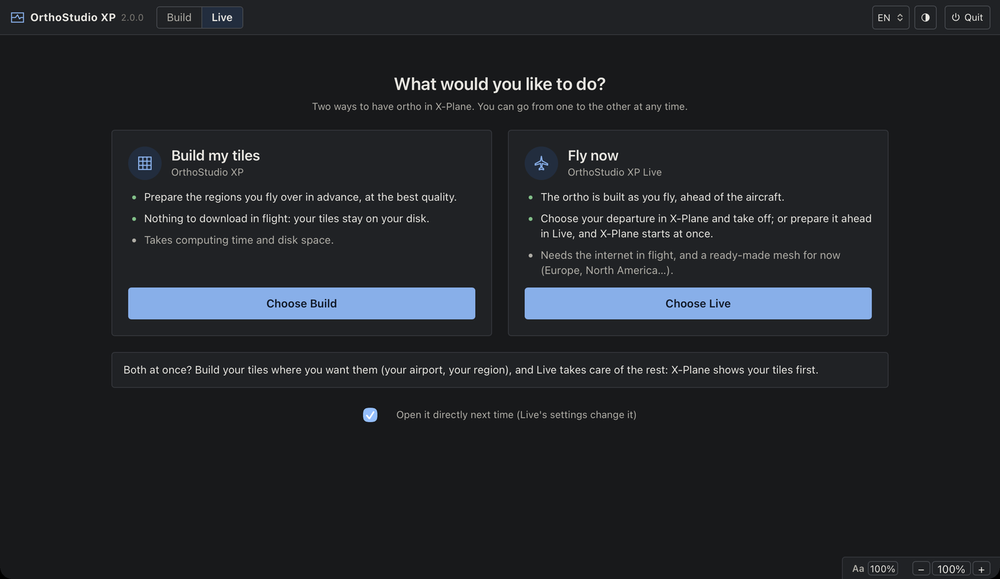
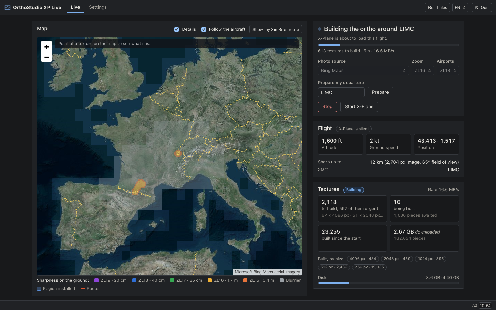
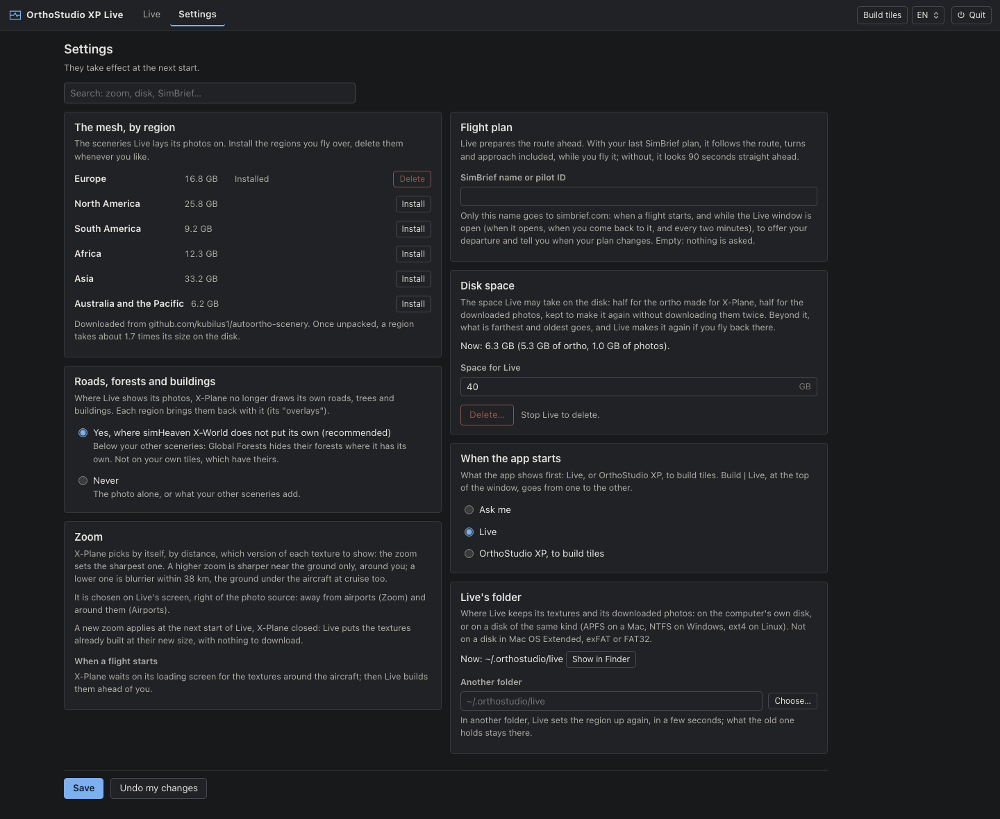

# OrthoStudio XP Live

Aerial imagery under your aircraft wherever you fly, downloaded while you fly, with no tiles to
build first. OrthoStudio XP Live comes with OrthoStudio XP from version 1.1, in beta.

This guide is for pilots: what Live does, what you do, and why it asks for so few settings. The
design and the measurements behind it are in [specs/live.md](specs/live.md) and
[specs/live/](specs/live/).

## Contents

- [What it is](#what-it-is)
- [Compared with XPME and AutoOrtho](#compared-with-xpme-and-autoortho)
- [Getting started](#getting-started)
- [A flight, step by step](#a-flight-step-by-step)
- [The window](#the-window)
- [The zoom](#the-zoom)
- [Imagery sources, your own tiles, roads and forests](#imagery-sources-your-own-tiles-roads-and-forests)
- [The mesh, by region](#the-mesh-by-region)
- [What happens while you fly](#what-happens-while-you-fly)
- [Why there are no zoom by flight level, prefetch or waiting settings](#why-there-are-no-zoom-by-flight-level-prefetch-or-waiting-settings)
- [Where everything is, and the disk](#where-everything-is-and-the-disk)
- [If something goes wrong](#if-something-goes-wrong)
- [Limits](#limits)

## What it is

Live works as AutoOrtho and XPME do from the pilot's seat: you choose a flight anywhere, and the
ground is aerial imagery. The difference is where it sits.

- **No virtual disk.** AutoOrtho and XPME put a virtual disk between X-Plane and its textures (FUSE,
  or an NFS server on a Mac): X-Plane asks for a texture and waits while they download and build
  it. Live stands beside X-Plane: it builds the textures before X-Plane asks for them and puts them
  on the disk as ordinary files. There is nothing to install for it, no kernel extension, no
  driver.
- **X-Plane never waits in flight.** It waits only on its loading screen at a flight's start, until
  the ground it shows first is built. In flight a texture that comes late is shown a little blurry,
  and sharper at the next look.
- **If Live stops, X-Plane flies on** over what is on the disk. Nothing is pulled from under it.
- **Light on the computer.** Live took about a third of one processor core in flight, a quarter of
  what XPME took on the same flight (measured below).
- **Faithful to the photos.** The textures are the photos as the source delivers them, without an
  added sharpening.

At the first start the app asks what you want to do: build your tiles, with OrthoStudio XP, or
fly now, with Live. Both are in one window, and you can go from one to the other at any time.

## Compared with XPME and AutoOrtho

The same flight with each program, on the same Mac (Apple M4 Pro, 48 GB), on 8 and 9 October
2026: X-Plane 12 flown by OrthoStudio XP's test pilot along the same path, nothing downloaded
beforehand (empty caches), Bing Maps photos at ZL16 and ZL18 near airports: AutoOrtho with its
default settings, XPME at its "Normal resolution" with its user's other settings, Live with its
defaults. Around Toulouse, 20 minutes low over
the plain; then over the Pyrenees, 18 minutes from high ground down a valley (XPME 4.7.23 and Live
only).

| | XPME | OrthoStudio XP Live | AutoOrtho |
|---|---|---|---|
| Start, Toulouse: from the flight starting to load to its first image | 125 s | 56 s | 297 s |
| then frozen before flying | 77 s | 4 s | 41 s |
| Start, Pyrenees: load to first image, then frozen | 112 s, then 42 s | 45 s, then 4 s | |
| Processor in flight (cores, median) | 1.27 (Pyrenees 1.25) | 0.32 (Pyrenees 0.37) | 0.57 |
| Program's memory in flight, median / most | 2.5 / 6.7 GB | 2.9 / 4.8 GB | 3.8 / 5.3 GB |
| X-Plane's frame rate, Toulouse | 57.2 fps | 57.2 fps | 57.3 fps |
| X-Plane loading scenery in flight, Toulouse | 58 s and 44 s | 24 s and 20 s | one of 278 s |
| Downloaded, start / flight, Toulouse | 0.69 / 1.31 GB | 0.60 / 1.18 GB | 2.29 / 1.86 GB |
| Written to the disk, start / flight, Toulouse | 1.92 / 3.81 GB | 2.54 / 4.19 GB | 3.92 / 4.03 GB |

What the figures say:

- **The start.** X-Plane's own opening takes about 25 s with each. After it, Live had the ground
  ready about twice as fast as XPME and five times as fast as AutoOrtho, and X-Plane flew 4 s after
  the first image, where it stayed frozen 41 to 77 s with the others. With "Prepare my departure"
  (below), Live builds the start before X-Plane loads it, and X-Plane waits for nothing.
- **In flight**, the frame rate is the same with all three: none of them slows X-Plane down. When
  X-Plane loads the scenery of a new area, it takes half as long with Live, whose files are already
  on the disk.
- **The processor**: Live a third of a core, XPME more than one.
- **The disk**: Live writes more than XPME (over the Pyrenees, 8.3 GB against 4.7), its weak point:
  each texture is written whole as it gets sharper.
- **Sharpness**: on the same views, Live's screenshots measured 3 % less fine detail than XPME's,
  and AutoOrtho's 4.8 %. XPME sharpens its textures (3.7 to 6 % more detail than the photos
  themselves, and more contrast), where Live keeps the photos as they are.

One flight each: the large gaps (the start, the processor, the scenery loads) are clear, the gaps
of a few percent (sharpness, memory, writes) would want more flights before being taken as rules.
How the flights are made and measured: [specs/live/flights.md](specs/live/flights.md).

## Getting started

1. **Install the mesh of where you fly.** Live lays its photos on a mesh, the ground's shape, in six
   regions: Europe, North America, South America, Africa, Asia, Australia and the Pacific. Settings,
   first question, Install (see [The mesh, by region](#the-mesh-by-region)). A region AutoOrtho's
   installer already put in X-Plane is found and used as it is.
2. **Choose the photos and the zoom**, at the top of Live's tab: the photo source (Bing Maps by
   default), the zoom away from airports and the zoom around them (ZL16 and ZL18 by default).
3. **Optionally, your SimBrief name** (Settings, Flight plan): Live then follows your plan in
   flight, and offers your last plan's departure to prepare.

The first start then prepares the region for X-Plane, once, in a few seconds (up to a minute on a
slow disk).

## A flight, step by step

1. **Prepare my departure** (optional): type the airport (or `lat,lon`) and click Prepare. Live
   builds the ground around it now, before X-Plane loads the flight: X-Plane then passes its
   loading screen at once. With your SimBrief name, the box already holds your last plan's
   departure ("Last SimBrief plan"); a newer plan made on simbrief.com is offered with "Load it".
   Prepare starts Live if it is not running yet: skip the next step then.
2. **Start Live.** The "From scratch" box beside it forgets every texture built and all imagery
   downloaded, as the very first time.
3. **Start X-Plane** (the button beside Live's), choose your flight and click Start Flight. X-Plane
   waits on its loading screen until the ground around your departure is built: a few seconds
   where you have flown before, a minute or two the first time in a new area. Live's window and a
   small panel over X-Plane count down the textures left, with the download rate, or « every photo
   in, building » once only the building is left. X-Plane's own window looks frozen meanwhile: it is
   waiting, it has not crashed.
   

4. **Fly**, anywhere. Another flight started from X-Plane's menu waits the same way.
5. **Quit X-Plane, then Stop.** Live takes its scenery and its small plugin out of X-Plane. Stopped
   while X-Plane still runs, Live waits for X-Plane to quit first ("Leave it installed" stops
   waiting).

## The window

Live and OrthoStudio XP are one app, in one window. At the top, Build | Live shows one side or the
other, with what the other is doing in a word beside its name (build under way, in flight), and
the tabs of the side shown. The language, the theme, Quit, and at the foot the text size and the
zoom, are there once for both. A build started while Live streams, or a flight while a build runs,
asks first: a build takes a lot of processor time and may slow X-Plane down.

**Live's tab** is laid out as OrthoStudio XP's Plan: the map on the left, as tall as the screen,
and on the right:

- **The state**: Ready, Starting, X-Plane waiting with a countdown, Following the aircraft, with
  what to do next. Under it the photo source and its two zooms on one line (chosen before Start,
  locked while Live runs, what each zoom does in its hover), the departure to prepare, and Live's
  buttons: Start Live (with its From scratch box), Start X-Plane, Stop.
- **Flight**: whether X-Plane sends its position; the altitude, the ground speed and the position;
  how far X-Plane's image is sharp (from your screen's width and field of view), the SimBrief plan
  while the aircraft follows it, the camera when it is away from the aircraft, and the departure.
- **Textures**: what they are doing (all built, building, late, downloads refused or failing) and
  the download rate; four boxes: to build (and how many are urgent), being built, built since the
  start, downloaded; the textures built by size; Live's disk space.
- Under them, the **checks**: what Live needs (X-Plane, a mesh under where you fly, no other program
  streaming ortho, its plugin), with a button to the regions where a mesh is missing; and the
  **log**.

**The map** shows the photos of your source, the borders and airports, the aircraft along its
heading (and the camera in external views), your SimBrief route while you fly it (or with "Show my
SimBrief route"), and the textures already built, coloured by how sharp they are on the ground:
ZL19 violet (about 20 cm a pixel), ZL18 blue (40 cm), ZL17 green (85 cm), ZL16 amber (1.7 m), ZL15
orange, grey blurrier. Zoomed out, the regions installed are shaded. Point at a texture and a bar
over the map says what it is: its photos, its tile, its pixels, its disk, when Live last had it in
reach ("Details" hides the bar). Your own tiles are framed, as on the Plan. The map follows the
aircraft, and comes closer on it when a flight starts (about 30 km across); drag it away in flight
to look elsewhere, and "Follow the aircraft" brings it back. The next flight is followed again by
itself.

**The Settings tab**: the mesh's regions, the roads, forests and buildings, what the zoom does, the
flight plan, Live's disk space (with what the textures and the imagery take, and a button to delete
either), what the app opens on, and Live's folder. They apply with Save, at the next start.

## The zoom

As in AutoOrtho: a zoom away from airports (ZL14 to ZL17, ZL16 by default) and a zoom around them
(ZL16 to ZL19, ZL18 by default, for the mesh's airport textures). X-Plane picks by itself, by
distance, which version of a texture it shows; the zoom sets the sharpest version there is, the
one seen up close.

- **Below the default**, a texture is smaller (1024 px at ZL14): less sharp near the ground, four
  times less to download for each step, shorter waits at a start. It is blurrier within about
  38 km, the ground under the aircraft at cruise too.
- **One above** (ZL17, ZL19), a texture is 8192 px: sharper near the ground only, within about
  15 km of the aircraft, of its path and of the camera at ZL17 (about 4 km at ZL19 around
  airports). It takes more memory: with less than 32 GB, the
  window says X-Plane may stutter and recommends the default. Above about 18,500 ft over the ground,
  Live stops fetching those 8192 px photos, which the screen cannot show from so high, and takes
  them up again on the way down.
- **A new zoom** applies at the next start of Live, X-Plane closed, at once: each texture takes its
  new size only when X-Plane comes near it, round your departure or ahead of the aircraft, keeping
  what it built and downloading nothing. Textures where you never fly again are never touched, and
  going back to your earlier zoom before flying near them loses none of their sharp photos.

Downloads, estimated around Lyon at 250 kt: with ZL16 and 18, about 1 GB at the start and 7 GB an
hour; with ZL17 and 19, about 1.4 GB and 13 GB.

To see where X-Plane really shows the 8192 px: "Test: show the 8192 px textures in pink" (Settings,
Zoom) builds that level washed with pink. Untick it after, and delete the textures: they are built
again, their sharpest photos downloaded again.

## Imagery sources, your own tiles, roads and forests

**Sources.** OrthoStudio XP's: Bing Maps, Esri, EOX, the countries' own (Spain's PNOA, the
Netherlands' PDOK...), and the sources you added in OrthoStudio XP's Plan; plus two AutoOrtho
offers, Esri's Firefly (the same photos as Esri, softer colours) and NAIP (the United States).
Google, Yandex and Apple are not offered: their terms forbid taking their photos outside their own
applications. A country's source has nothing past its border: there, and wherever it has no
imagery, Live takes Bing Maps. The source's credit and licence are at the foot of the map.
Textures already built keep their photos: "From scratch" builds them all again with a new source.

**Your own tiles come first.** Where you built a tile with OrthoStudio XP (or imported one from
Ortho4XP, or installed another ortho scenery above Live's), X-Plane shows it, and Live downloads
nothing there: at a start from your home airport, X-Plane waits for none of it. The map frames
them, and the checks list them.

**Roads, forests and buildings.** Where Live shows its photos, X-Plane no longer draws its own:
each region brings them back as "overlays", which Live puts on its squares, except where simHeaven
X-World brings its own, on your own tiles, and where another overlay pack is on (AutoOrtho's,
Ortho4XP's). Global Forests needs nothing. "Never" leaves the overlays out.

## The mesh, by region

Live lays its photos on AutoOrtho's mesh: the ground's shape and the textures' outlines, in six
regions you install once, the ones you fly over, and delete whenever you like: Europe (17 GB),
North America (26 GB), South America (9 GB), Africa (12 GB), Asia (33 GB), Australia and the
Pacific (6 GB). Unpacked, a region takes about 1.7 times its size. An install goes on where it
stopped: after a dropped connection, Stop or the Mac asleep, Install again and it carries on. A
region is used from the next start once it is whole. In a terminal: `python -m orthostudio.live regions list`, `regions install eur`,
`regions remove eur`.

They come from github.com/kubilus1/autoortho-scenery, where AutoOrtho's author publishes them. Live
downloads them from there and never publishes them anywhere else: that repository names no licence.

Where no region installed has a mesh, X-Plane shows its own scenery, without photos: Live says so,
in its window and in a small panel in X-Plane ("Live: no mesh here: install North America in the
Live window"). Over the
open sea, where no region has any mesh, it says nothing: that is why the shade of the regions on
the map leaves out squares of open sea.

## What happens while you fly

Every two seconds Live reads where the aircraft is, where it is heading and how fast, and where the
camera is. It looks two minutes ahead along the track (ten minutes of your SimBrief route while you
follow it), and for every texture within 300 km it works out how sharp X-Plane will want it when the
aircraft, or the camera, passes closest. What is missing is downloaded and built, the most urgent
first. X-Plane picks the new file up by itself the next time it wants that texture sharper.

X-Plane decides how sharp a texture must be from its distance, in rings. For a normal texture
(about 7 km across), as measured on a 2,704 px wide image with a 65° field of view:

| distance to the texture | what X-Plane reads | imagery |
|---|---|---|
| 130 to 230 km, when X-Plane loads the area | 256 px | ZL12 |
| 72 km | 512 px | ZL13 |
| 38 km | 1024 px | ZL14 |
| 21 km | 2048 px | ZL15 |
| under 12 km, texture quality at Maximum | 4096 px | ZL16 |

On a wider screen, or zoomed in, X-Plane reads sharp textures farther, and Live builds them farther
too; the Flight card says how far for yours. Airport textures (about 1.8 km across) follow the same
law four times closer. The 4096 px level is never fetched when X-Plane's texture quality is below
Maximum: X-Plane then never reads it.

External views count: X-Plane measures from the camera. With Shift+4 the camera can go kilometres
away in a second, faster than anything downloads, so Live keeps the sharp levels built 10 km
farther around the aircraft than the aircraft alone needs. A camera taken farther than that may
find the neutral colour, green-grey, until X-Plane loads that area again.

**The plugin.** To make X-Plane wait at a start, Live puts a small plugin in X-Plane while it runs,
and takes it out when it stops. It holds X-Plane on its loading screen as long as the ortho keeps
arriving, and lets it go when everything there is built, when nothing has downloaded for a minute
(no internet, or a source refusing every request: `LogLive.txt` says why), or when you click Stop.
It never holds X-Plane in flight, and does nothing when Live is not running. In flight it shows
Live's notices in a small panel (no mesh under the aircraft), and measures X-Plane's frames: Live
logs a frame of 100 ms or more as a stutter, with what it was doing then. While X-Plane flies, Live
builds at most four textures at once, at a low priority: X-Plane's threads always go first.

## Why there are no zoom by flight level, prefetch or waiting settings

AutoOrtho's settings are there to manage X-Plane's wait: since X-Plane is blocked while AutoOrtho
downloads, you choose how much to download, how long X-Plane may wait before it gets a blurry
texture instead, and how far ahead to guess. It is a trade between sharpness and freezes, and you
set it. Live has no wait to manage, and X-Plane itself says how sharp it wants each texture:

| AutoOrtho setting | In OrthoStudio XP Live |
|---|---|
| Minimum zoom | Not needed: the far view is the 256 px level X-Plane reads when it loads an area. |
| Maximum zoom, zoom near airports | The same two, on Live's tab beside the photo source ("Zoom" and "Airports"). |
| Zoom by flight level | Not needed: X-Plane already reads less sharp when the ground is farther away, and Live follows it. Only the 8192 px photos stop above about 18,500 ft over the ground. |
| Prefetch radius, look-ahead, interval | Built in and measured: 300 km around, two minutes ahead along the track (ten minutes along a SimBrief route), the rings with a 25 % margin, and 10 km more for external views. |
| Maximum wait, time budget, fallbacks | Not needed: X-Plane waits only while a flight loads, until everything it reads there is built. In flight it never waits. |
| Cache sizes, workers, pipelines | Internal. |

What you choose: the photo source, the zoom, and how much disk Live may take.

## Where everything is, and the disk

Live's folder is `~/.orthostudio/live` (`%USERPROFILE%\.orthostudio\live` on Windows), unless its
settings choose another, on the computer's own disk or one of the same kind: APFS on a Mac, NTFS on
Windows, ext4 on Linux, never Mac OS Extended, exFAT or FAT32.

- `pack`: the scenery X-Plane reads, linked into Custom Scenery as `z_osxp_live` while Live runs.
  The files X-Plane looks for are there; the textures are built for real where you have flown, and
  a neutral placeholder that takes no space elsewhere (a disk-usage tool counts every placeholder
  whole: they share one file).
- `chunks.sqlite`: the downloaded imagery, so that it is not downloaded twice. The photos of the
  sharpest levels (4096 and 8192 px) are kept in the textures themselves instead: a texture made
  coarser for the disk, then built sharp again, downloads them again.
- `regions`: the mesh's regions Live installed.
- `overlays`: the roads, forests and buildings of Live's squares, linked as `y_osxp_live_overlays`
  while Live runs.

The textures and the imagery share one disk space, 40 GB by default, set in the Settings tab. Past
it, Live makes the textures seen longest ago coarser, only where nothing can show it, and drops the
imagery used longest ago. The same tab deletes the textures (built again when flown over) or the
imagery (downloaded again when needed).

On Windows, Live keeps its folder out of Windows Search, whose indexing of its many files kept the
indexer busy for whole flights. Microsoft Defender checks each new file Live writes, which took
about one core for a while at Live's first start. To spare it, add Live's folder as an exclusion
(Windows Security, Virus & threat protection, Manage settings, Exclusions, Add an exclusion,
Folder): a security setting for you to choose, which Live never changes itself.

To switch Live off, put `enabled = false` in `live.toml`, in OrthoStudio XP's own folder
(`~/.orthostudio`, `%USERPROFILE%\.orthostudio` on Windows).

## If something goes wrong

- Live keeps its log in `LogLive.txt`, at the top of your X-Plane folder, beside X-Plane's own
  `Log.txt`: send both when something went wrong. It is written again each time Live's window
  opens, so send it before opening Live again; the ten before are kept in Live's `log` folder.
  The window's Log has a button that shows it in the Finder (File Explorer on Windows).
- If Live stops, X-Plane goes on flying over what is on the disk. If the streamer stops on an
  error, the window says so with the error, and the plugin lets X-Plane go on.
- If a texture comes late, X-Plane shows it a little blurry and sharpens it at its next ring.
- If the photo source refuses your connection (access denied), Live says so under the source and
  the textures read "Downloads refused": stop Live, choose another source, start it again.
- Quit X-Plane before Stop: Live takes its scenery and its plugin out when it stops, and waits for
  X-Plane to quit first.
- Quitting the app while Live streams asks first, in the window.

## Limits

- Only where AutoOrtho has a mesh: the six regions cover the land of the planet, a few islands
  excepted.
- Flown with X-Plane 12 on a Mac and on Windows; not yet on Linux.
- The camera's reach (10 km around the aircraft) is kept in the cockpit too: an external view comes
  without warning, and X-Plane reads a texture once. Live notes how far external views take the
  camera, flight after flight, to set it on how pilots really fly.
- From a checkout of the repository, `uv run python -m orthostudio.live ui` opens the window and
  `stream` runs Live in a terminal; on a Mac the plugin is compiled the first time, which needs
  Xcode's command-line tools (`xcode-select --install`).
