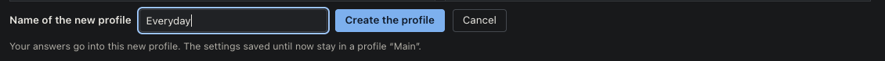
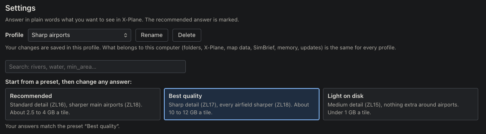
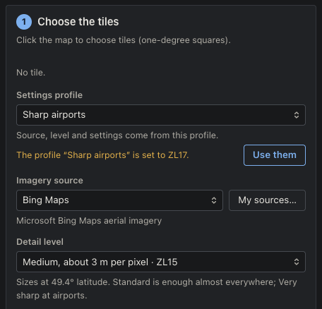

# OrthoStudio XP manual: clouds and settings profiles

What came with 1.4.0, step by step, with where to click. The rest of the app is described in the
[README](../README.md) and in [how it works](how-it-works.md).

- [Replacing the clouds of a tile](#replacing-the-clouds-of-a-tile)
- [Settings profiles](#settings-profiles)

## Replacing the clouds of a tile

Aerial photos are sometimes taken under a few clouds, and a tile built from them shows the clouds
on the ground in X-Plane. OrthoStudio XP finds them and puts in their place the ground of another
source that was clear there: Esri, EOX, or a national source such as PDOK in the Netherlands. You
choose which clouds go and which source takes each one; the tile keeps your choice in every build
after. What the map shows is what X-Plane shows.

### 1. Open the tile's clouds

In the **Library**, on the line of a tile built by OrthoStudio XP, press **Clouds…**. The Plan's
map comes over the tile, drawn as X-Plane draws it, from the tile's own files: nothing is
downloaded. Any tile built by OrthoStudio XP can have its clouds replaced, whatever version built
it.

### 2. Look for the clouds

Press **Quick search**, or **Fine search** to find the small clouds too, in about twice the time
(it is greyed on a tile built no finer than the quick search reads). The first time, the app asks
to download the tool that finds the clouds: about 110 MB, OpenCV included, depending on the
system. It is downloaded once and runs on your computer: nothing is sent anywhere.

The search reads the tile (the fine one a second time in more detail, where the tile is sharp enough
to hold small clouds), then tries every other source covering the tile under each cloud: whether it
has a picture there, whether it is clear, and how well its ground fits the photo around the cloud.
On a ZL14 tile it takes about a minute. The panel shows where it is; **Stop** ends it.

### 3. Choose what to replace

Each cloud found is outlined in yellow on the map and listed in the panel with its size and its
sources, for instance *Esri World Imagery · clear · fit 93 %*, the best first. A source showing
the same photo as the tile, which would bring the cloud back, or with no picture there, is greyed.

- Every cloud comes **unticked**. The tool can take something pale for a cloud, such as light,
  muddy water near a coast: look before you tick. **Show** brings the map to a cloud.
- **Tick** a cloud, or click its outline on the map (its tooltip says what a click does; its row
  comes to the middle of the list): its source's images are fetched at the
  tile's own sharpness, in a few seconds, and its line says *Replaced by Esri World Imagery after
  Apply*. Its outline turns to the accent colour. If the tool that finds clouds is not on your
  computer yet, the app asks first; say no, and the cloud stays ticked, waiting for its images.
- To take another source, choose it in the cloud's list: it is ticked with it.
- **Tick all** and **Untick all**, above the list, tick or untick every cloud at once. While
  clouds' images are being fetched, **Stop all** beside them stops every one at once.
- A spinner says that a cloud's images are being fetched, in its row and at its centre on the
  map. A found cloud shows its number inside it; one too small to see at the map's zoom has a pin
  you can click.
- A source that did not answer or refused for now says so in the line, and stays the cloud's
  source: **Get its images** asks it again.

### 4. Before and After

The banner over the map has two views:

- **After**: what X-Plane shows, read from the tile's own textures, or what it will show once you
  press Apply: where Apply will change a texture, the clouds it lays there are drawn over it.
- **Before**: the tile with no cloud replaced.

### 5. A cloud the search missed: outline it

Press **Outline a cloud** in the banner, then click around the cloud on the map, point by point.
Double-click the last point, or press Enter, to close it; Escape gives up. The outline is tried
under the sources at once, then takes the place of the clouds found under it and comes in the list
ticked with the best, named *Outline 1*, with a bin to take it out. Stop it while its sources are
tried, and it goes: the clouds found under it stay.

### 6. Apply

Nothing changes in X-Plane until you press **Apply (3 changes)**. The app says what will change,
and what waits (a cloud whose images are not in yet stays out). Apply does not build the tile: it
changes only the pixels under the clouds in its textures, in a few seconds, and the panel shows
how far it is. The rest of the tile stays exactly as built. It is all or nothing: if a texture
cannot be replaced, nothing changes and the app says why. On Windows, quit X-Plane first if it
shows the tile: it holds the textures and they cannot be replaced while it runs.

While the tile is being built, waits in the queue, or is being filed in the Library, its clouds
are shown as they are, and nothing can be changed: they are back once that is over. A build of
the tile waits a moment for a task of its clouds to end first (Apply ends what it began, the
others stop).

**Discard changes** puts the list back to what the tile holds.

### 7. Afterwards

The tile keeps its clouds replaced: every build of it after, from the Plan, the Library, Works or
the command line, lays them again on the same photo as soon as it has finished the tile, before the
other tiles of the same build. The Library says how many it has replaced and how many wait.

A cloud is chosen on a photo. Build the tile from another source or at another level, change the
colours of the tile or of a zone near the cloud, or let its source send new images, and the photo
under the cloud is another one. The build then puts the photo back there, as photographed, and
the cloud's line says why. It stays ticked: get its images again on the new photo, and one
**Apply** replaces it again. Go back to the first settings, and the next build lays it again by
itself.

**Restore the original photos** asks, then puts every texture back as built, in a few seconds,
and unticks the clouds; your list stays, to tick them again later. Deleting a tile forgets its
clouds.

## Settings profiles

A profile is a set of settings kept under a name, to build some tiles one way and others another:
sharp, with every airfield, for the mountains you fly low over; light for the plains you cross.

### 1. Make a profile

In **Settings**, change the answers you want, or start from a preset. Then press **Save as a new
profile…** beside **Save**. The bar asks for a name: type it and press **Create the profile**.

The settings saved until then stay in a profile of their own, called *Main* the first time.

### 2. The profile in use

The top of Settings shows the profile in use. Choose another in the list to work on it; **Rename**
and **Delete** act on the one shown. **Save** says which profile it writes into, for instance
*Save in "Everyday"*.

A profile keeps the look of the tiles: every question, the photo colours and the expert settings.
What belongs to the computer is the same for all of them: the X-Plane folder, the data folder,
SimBrief, the map data, the update check and the memory a build may take. Deleting a profile
deletes only its settings, never a tile.

### 3. Build with a profile

In step 1 of the **Plan**, **Settings profile** sets the build's imagery source, detail level and
every other setting. You can still change the source or the level for one build. When they no
longer match the profile's, a line says what the profile holds, and **Use them** takes them back.

Works names the profile each build used.
